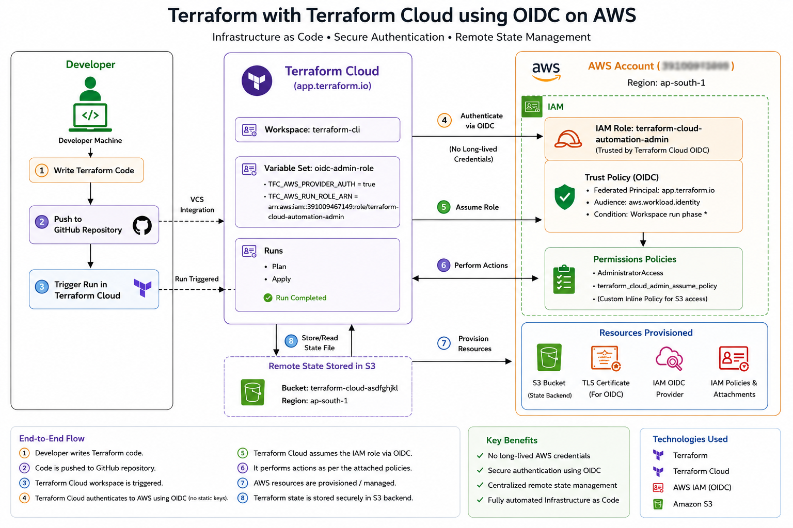
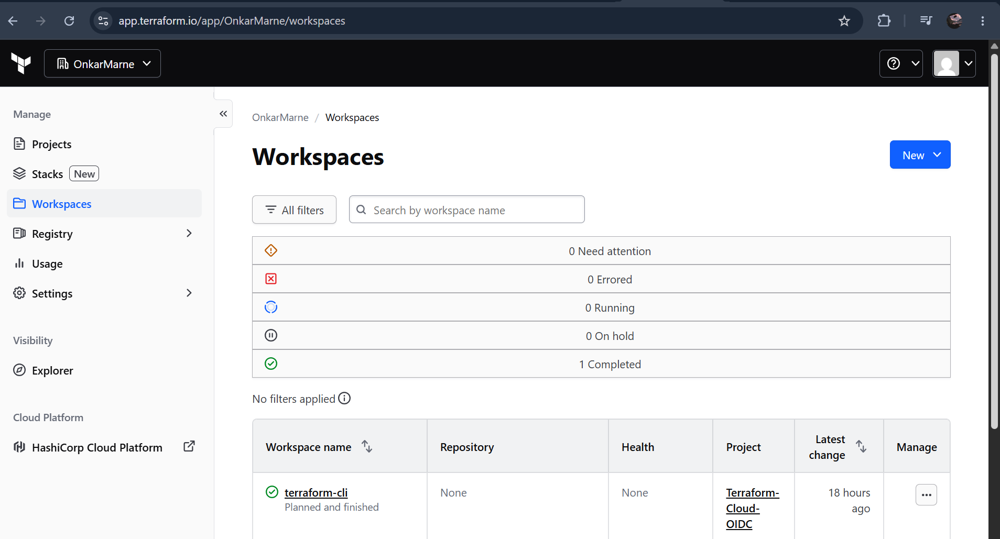
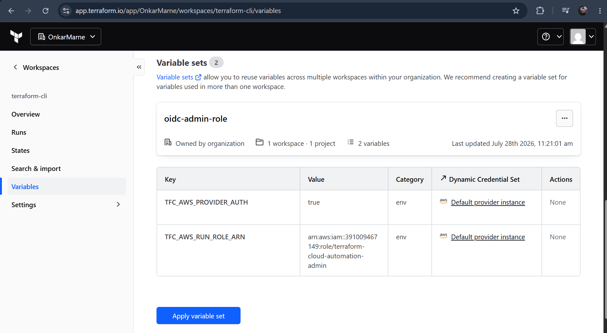
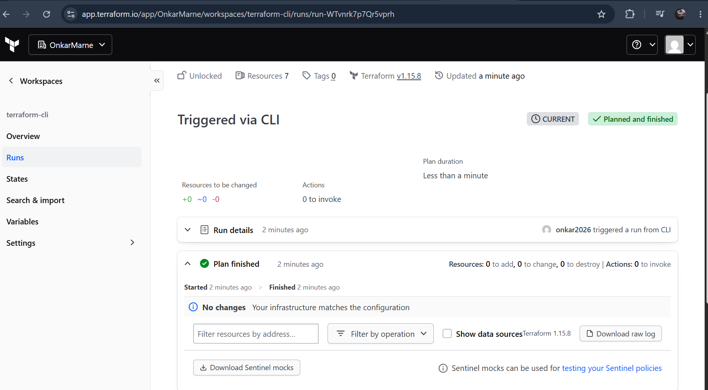
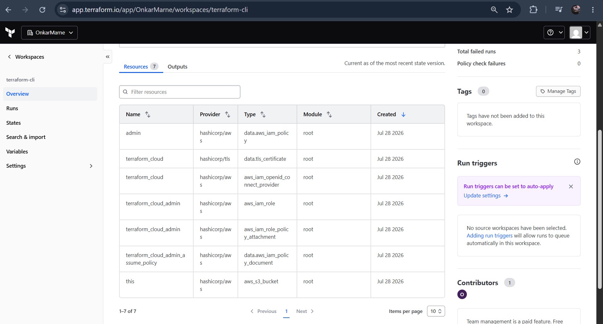
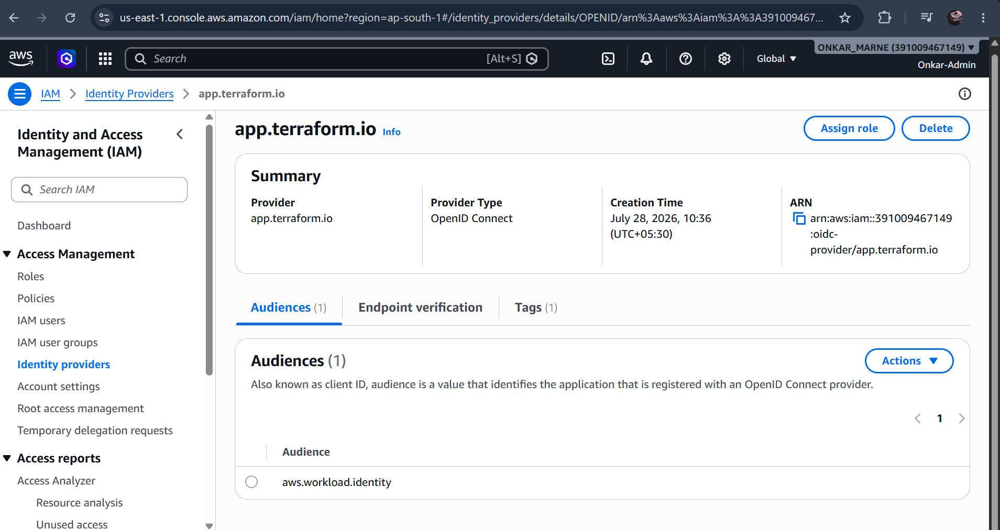
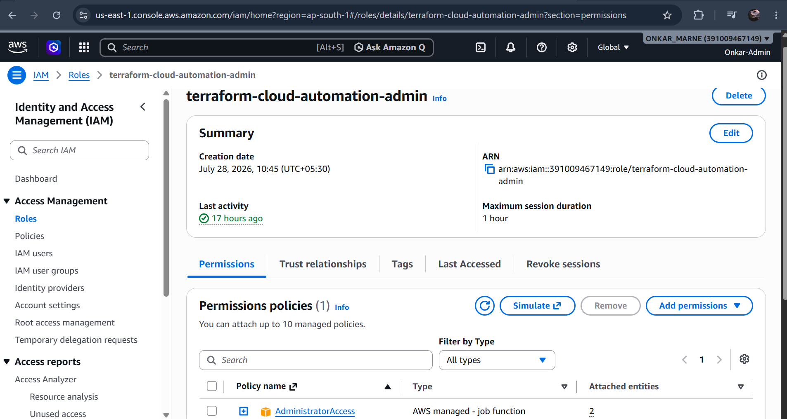
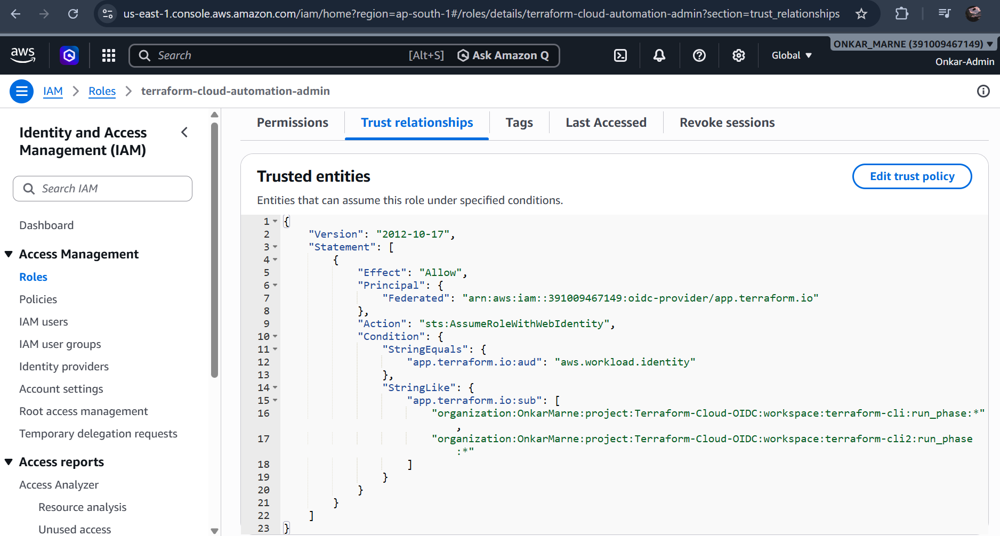
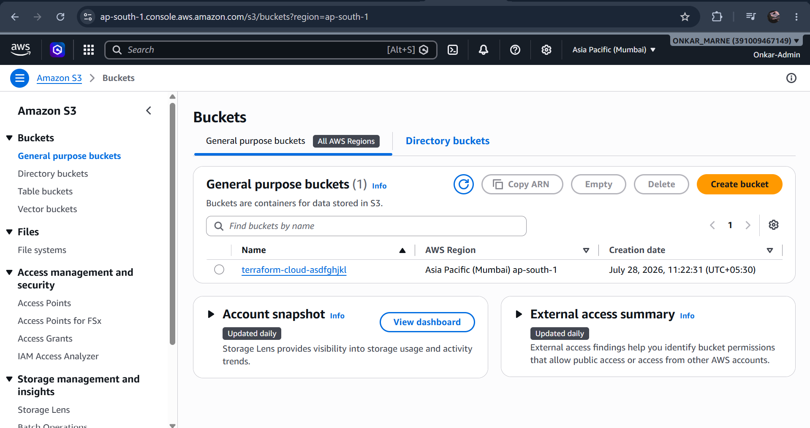
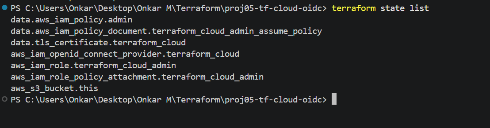

# Terraform Cloud AWS OIDC Integration

Provision AWS infrastructure securely from Terraform Cloud using OpenID Connect (OIDC), eliminating long-lived AWS credentials through IAM role federation and Infrastructure as Code (IaC).

---

## Project Overview

This project demonstrates how to securely authenticate Terraform Cloud with AWS using OpenID Connect (OIDC) instead of static IAM access keys. Terraform Cloud assumes an AWS IAM Role via `sts:AssumeRoleWithWebIdentity`, enabling secure, short-lived authentication for infrastructure provisioning.

The project also demonstrates importing existing AWS IAM resources into Terraform state, allowing manually created infrastructure to be managed through Infrastructure as Code.

---

## Architecture

The following architecture illustrates the authentication flow between Terraform Cloud and AWS using OpenID Connect (OIDC). Terraform Cloud requests a short-lived identity token, AWS validates it through the configured IAM OIDC Provider, and an IAM Role is assumed using AWS STS to provision resources securely without long-lived AWS credentials.

<p align="center">
  
</p>

---

## Features

- Secure AWS authentication using Terraform Cloud OpenID Connect (OIDC)
- Eliminates long-lived AWS Access Keys from Terraform Cloud
- IAM Role assumption using `AssumeRoleWithWebIdentity`
- Dynamic retrieval of OIDC TLS certificate thumbprints
- Workspace and project-level IAM trust policy restrictions
- Import of existing AWS IAM resources into Terraform state
- Infrastructure managed entirely using Terraform
- Terraform Cloud remote execution with centralized state management

---

## Technology Stack

| Category | Technologies |
|----------|--------------|
| Infrastructure as Code | Terraform, Terraform Cloud |
| Cloud | AWS IAM, AWS STS, Amazon S3 |
| Authentication | OpenID Connect (OIDC) |
| Language | HCL |
| Version Control | Git, GitHub |

---

## Project Structure

```text
proj05-tf-cloud-oidc/
│
├── screenshots/
├── oidc.tf
├── provider.tf
├── s3.tf
├── variables.tf
├── terraform.tfvars.example
├── .gitignore
├── .terraform.lock.hcl
└── README.md
```

---

## Infrastructure Components

The project provisions and manages:

- AWS IAM OpenID Connect Provider
- AWS IAM Role
- IAM Role Policy Attachment
- Amazon S3 Bucket
- IAM Trust Policy
- Terraform Cloud Workspace Configuration

---

## Authentication Flow

1. Terraform code is executed from a Terraform Cloud workspace.
2. Terraform Cloud requests an OIDC identity token.
3. AWS validates the token using the configured IAM OIDC Provider.
4. AWS evaluates the IAM Role trust policy.
5. Terraform Cloud assumes the IAM Role using `sts:AssumeRoleWithWebIdentity`.
6. Temporary AWS credentials are issued.
7. Terraform provisions AWS resources securely without storing AWS access keys.

---

## Screenshots

### Terraform Cloud Workspace



---

### Variable Set



---

### Successful Terraform Run



---

### Managed Resources



---

### IAM OIDC Provider



---

### IAM Role



---

### IAM Trust Policy



---

### Amazon S3 Bucket



---

### Terraform State



---

## Getting Started

### Clone the repository

```bash
git clone https://github.com/Onkar-M-Dev/terraform-cloud-oidc.git
cd terraform-cloud-oidc
```

### Configure variables

Create a `terraform.tfvars` file from the example:

```bash
cp terraform.tfvars.example terraform.tfvars
```

Update the variable values according to your Terraform Cloud organization and workspace.

### Initialize Terraform

```bash
terraform init
```

### Review the execution plan

```bash
terraform plan
```

### Apply the configuration

```bash
terraform apply
```

---

## Security Considerations

- No long-lived AWS credentials are used.
- Authentication is performed through OpenID Connect (OIDC).
- IAM trust policy restricts access by Terraform Cloud organization, project, and workspace.
- AWS permissions are granted through temporary STS credentials.
- Sensitive files such as Terraform state and local variable files are excluded from version control.

---

## Key Learning Outcomes

- Implemented secure workload identity federation between Terraform Cloud and AWS.
- Managed existing AWS IAM resources using Terraform import blocks.
- Designed reusable IAM trust policies using Terraform expressions and variables.
- Configured Terraform Cloud for remote execution and centralized Infrastructure as Code management.

---

## Future Improvements

- Extend the project using reusable Terraform modules.
- Implement least-privilege IAM policies instead of AdministratorAccess.
- Provision additional AWS services such as EC2, VPC, and RDS.
- Integrate GitHub Actions for automated Terraform validation and deployment workflows.